# Deformable DETR 课程报告图表

本目录由 `tools/generate_report.py` 自动生成，所有图片均为 200/180 dpi。
关键图片还会按编号平铺复制到项目根目录的 `report_figures/`，方便直接提交。

## 1. 数据集概况

- 训练集：4 张图像，13 个标注框
- 验证集：4 张图像，17 个标注框
- 标注中实际出现 12 个类别（见类别表）
- 模型：Deformable DETR + ResNet-50，输出 91 类 COCO 标签空间
- 权重：`output/checkpoint.pth`（训练 100 epochs）

> **数据说明（重要）**：`instances_*2017.json` 的 `categories` 字段只声明了 8 类
> （person/bicycle/car/motorcycle/airplane/bus/train/truck），但 `annotations`
> 中实际出现了 cat、dog、cow、bear、zebra、wine glass、spoon、bowl、pizza、
> keyboard 等类别，并且包含一个非标准 COCO id 26。下图与统计均以
> **annotations 中实际出现的类别**为准。
>
> 另外，部分标注与图像内容明显不符（例如长颈鹿图片被标为 zebra、花束图片被标为
> keyboard/pizza、斑马图片被标为 bear）。因此训练集检测图展示的是模型拟合这批
> 标注的能力，不能作为真实检测性能的依据；验证集只有 4 张图，
> 结论同样仅作流程演示。

### 1.1 声明类别与实际标注对比

| 类别ID | 类别名 | 训练集数量 | 验证集数量 |
|---|---|---|---|
| 1 | person | 0 | 10 |
| 2 | bicycle | 0 | 0 |
| 3 | car | 0 | 0 |
| 4 | motorcycle | 0 | 0 |
| 5 | airplane | 0 | 0 |
| 6 | bus | 0 | 0 |
| 7 | train | 0 | 0 |
| 8 | truck | 0 | 0 |

只有 person 在标注中真正出现（验证集 10 个），其余 7 个声明类别在标注中为 0。
这说明该 mini 数据集的类别元数据与标注文件不一致，建议在正式报告中注明。

### 1.2 实际类别统计表

| 类别ID | 英文名 | 中文名 | 训练集 | 验证集 | 合计 | 是否声明 |
|---|---|---|---|---|---|---|
| 1 | person | 人 | 0 | 10 | 10 | 是 |
| 17 | cat | 猫 | 0 | 1 | 1 | 否 |
| 18 | dog | 狗 | 0 | 2 | 2 | 否 |
| 21 | cow | 牛 | 0 | 2 | 2 | 否 |
| 23 | bear | 熊 | 1 | 0 | 1 | 否 |
| 24 | zebra | 斑马 | 2 | 0 | 2 | 否 |
| 26 | unknown (id=26) | 未知(26) | 0 | 1 | 1 | 否 |
| 46 | wine glass | 酒杯 | 3 | 0 | 3 | 否 |
| 50 | spoon | 勺子 | 4 | 0 | 4 | 否 |
| 51 | bowl | 碗 | 1 | 0 | 1 | 否 |
| 59 | pizza | 披萨 | 1 | 1 | 2 | 否 |
| 76 | keyboard | 键盘 | 1 | 0 | 1 | 否 |

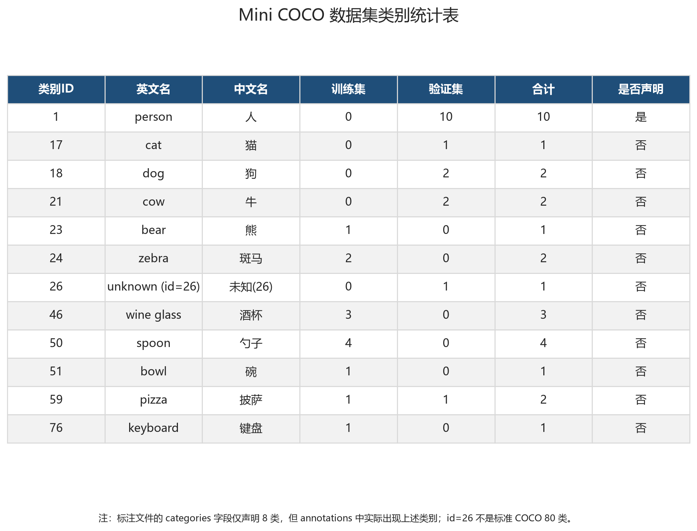

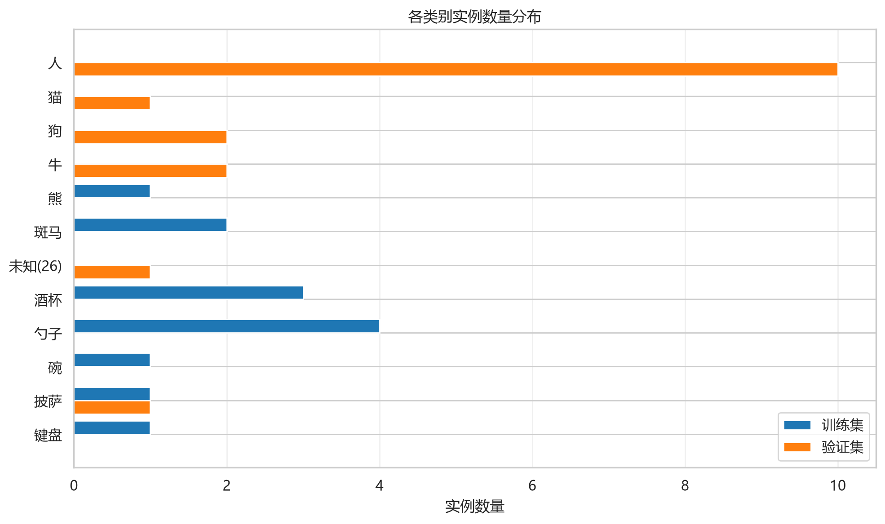

## 2. 损失函数曲线

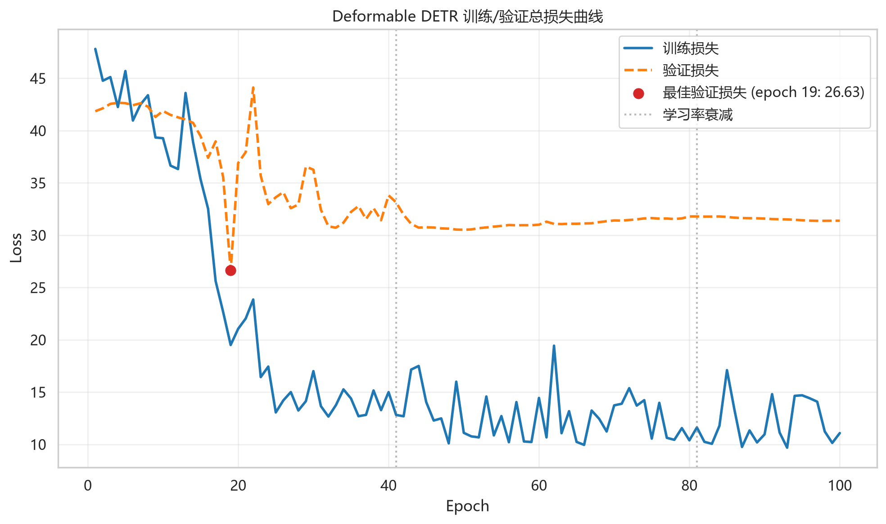

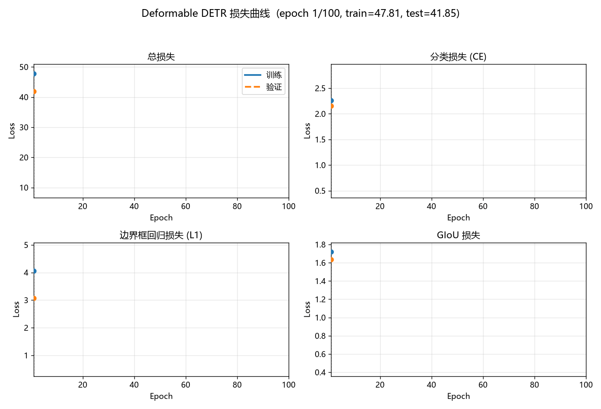

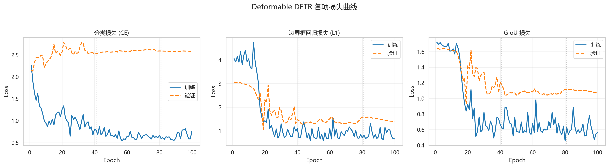

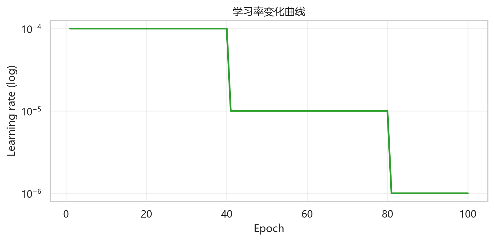

- 训练 100 epochs
- 最终训练损失：11.0740
- 最终验证损失：31.3841
- 最佳验证损失：26.6307（epoch 19）

## 3. 数据集检测结果

### 3.1 训练集（模型已过拟合训练标注）

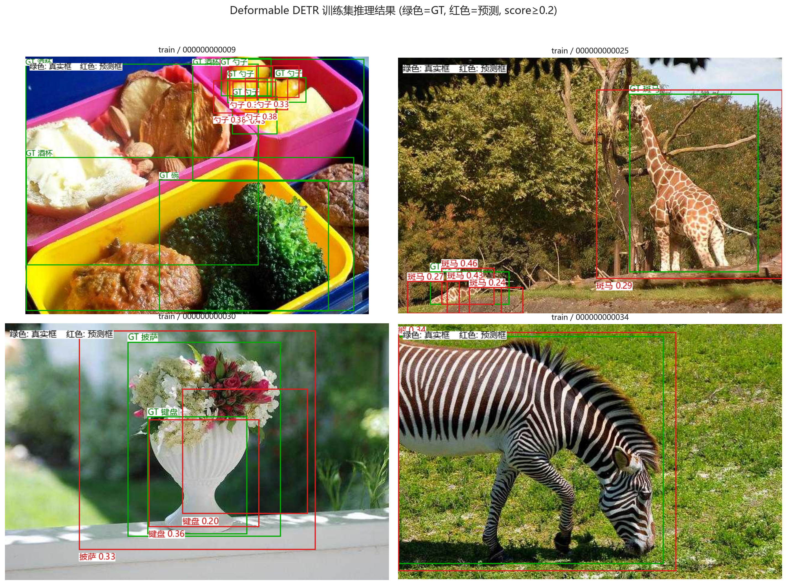

单张图片位于 `figures/detections_train/`。图中预测框与标注框吻合，说明模型已经
拟合了训练标注；但由于标注本身存在错误，预测类别不一定符合图像的真实语义。

### 3.2 验证集（仅 4 张图，泛化较差）

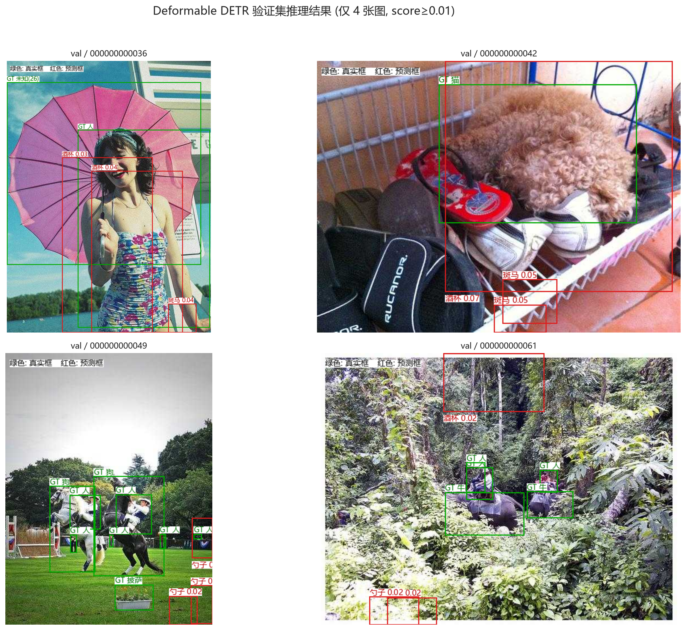

单张图片位于 `figures/detections_val/`。验证集预测分数很低，图中的框为
`score≥0.01` 且经过 NMS 的结果，仅用于展示推理流程，不代表模型泛化性能。

## 4. 混淆矩阵

### 4.1 训练集

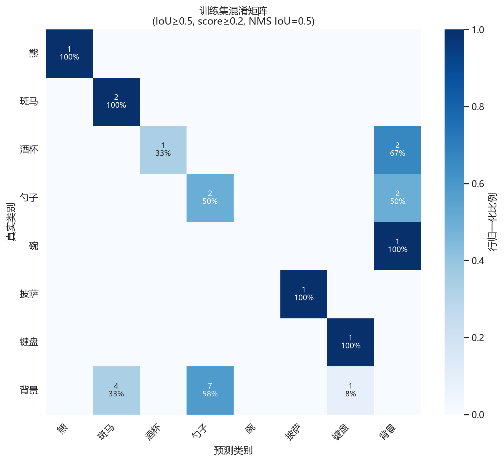

### 4.2 验证集

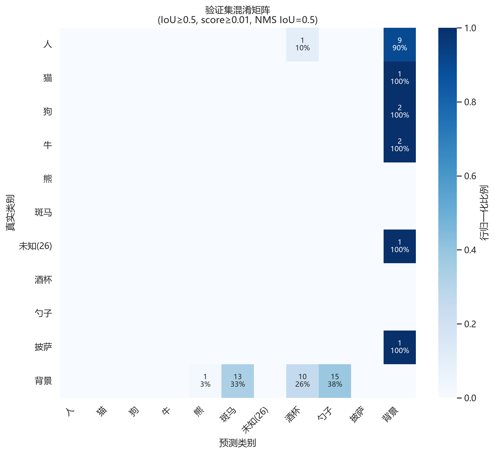

混淆矩阵按 IoU=0.5 做贪心匹配；训练集阈值 score≥0.2，验证集 score≥0.01，
均使用 NMS（IoU=0.5）。原始计数保存在 `tables/confusion_matrix_*.csv`。

## 5. 可实时查看的动态损失曲线

已提供 Streamlit 实时看板：

```bash
streamlit run tools/live_loss.py
```

如提示缺少依赖，可先安装：

```bash
pip install -r tools/requirements_report.txt
```

浏览器访问 `http://localhost:8501`。看板每 2 秒读取一次 `output/log.txt`，
支持：

- 总损失、分类损失、回归损失、学习率分页查看
- 自动刷新 / 回放模式（无需重新训练即可演示曲线动态增长）
- 最新 epoch、当前损失、最佳验证损失
- 下载当前损失数据 CSV

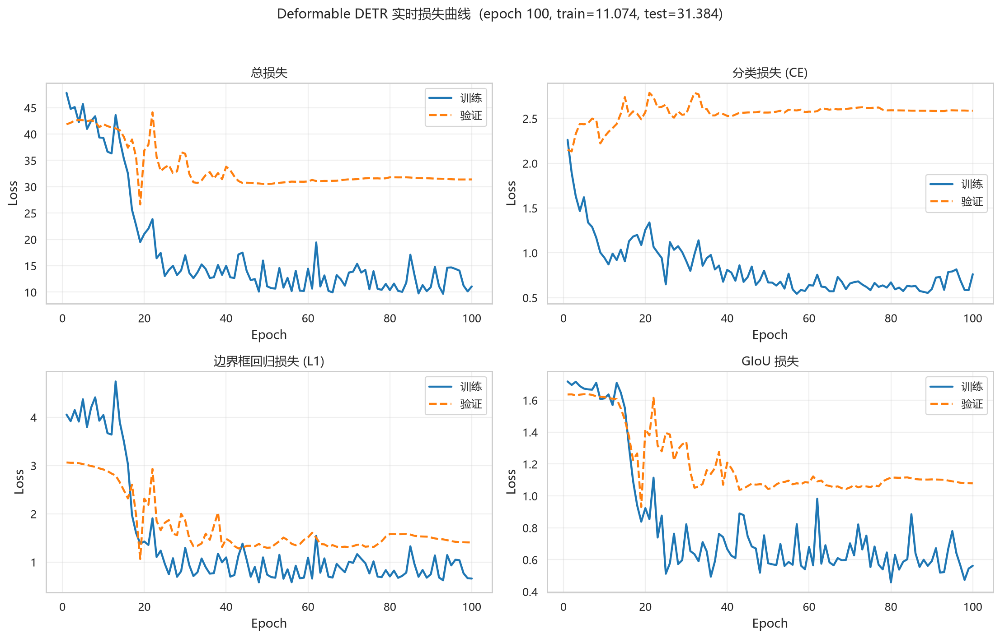

如果不想启动 Web 服务，也可以使用 matplotlib 窗口：

```bash
python tools/live_loss_matplotlib.py
```

也可以直接生成损失曲线动图：

```bash
python tools/make_loss_gif.py
```

## 6. 训练时同步查看实时曲线

双击或运行：

```bat
train_with_live_loss.bat
```

该脚本默认把本次训练输出到 `output_live/`（避免覆盖已有的 `output/`），
并同时打开一个 matplotlib 实时曲线窗口；窗口每 2 秒读取
`output_live/log.txt` 并自动刷新。也可以通过第一个参数指定输出目录：

```bat
train_with_live_loss.bat output_demo
```

如需自定义 epoch / batch size，请分别在两个终端运行：

```bat
python train_deformable_detr.py --epochs 10 --output_dir output_demo
python tools\live_loss_matplotlib.py --log output_demo\log.txt
```

## 7. 重新生成

```bash
python tools/generate_report.py --checkpoint output/checkpoint.pth --device cuda
```

## 8. 文件清单

| 文件 | 说明 |
|---|---|
| `figures/loss_curve.png` | 总损失曲线 |
| `figures/loss_curve.gif` | 损失曲线动图 |
| `figures/loss_components.png` | 分类/回归/GIoU 损失曲线 |
| `figures/learning_rate.png` | 学习率曲线 |
| `figures/class_table.png` | 类别统计表 |
| `figures/class_distribution.png` | 类别分布柱状图 |
| `figures/confusion_matrix_train.png` | 训练集混淆矩阵 |
| `figures/confusion_matrix_val.png` | 验证集混淆矩阵 |
| `figures/detection_results_train.png` | 训练集检测结果网格 |
| `figures/detection_results_val.png` | 验证集检测结果网格 |
| `figures/live_loss_preview.png` | 实时损失看板静态预览 |
| `tables/loss_history.csv` | 100 epoch 损失数据 |
| `tables/class_table.csv` | 实际类别统计表 |
| `tables/class_table.md` | 类别统计表 Markdown |
| `tables/declared_categories.csv` | JSON 中声明的 8 类统计 |
| `tables/predictions_train.csv` | 训练集 GT/预测框 |
| `tables/predictions_val.csv` | 验证集 GT/预测框 |
| `tables/confusion_matrix_train.csv` | 训练集混淆矩阵计数 |
| `tables/confusion_matrix_val.csv` | 验证集混淆矩阵计数 |

> 说明：验证集只有 4 张图，且与训练集类别分布差异很大，因此 COCO AP 为 0。
> 本报告的检测可视化和混淆矩阵主要用于展示模型推理流程与训练集拟合情况。
